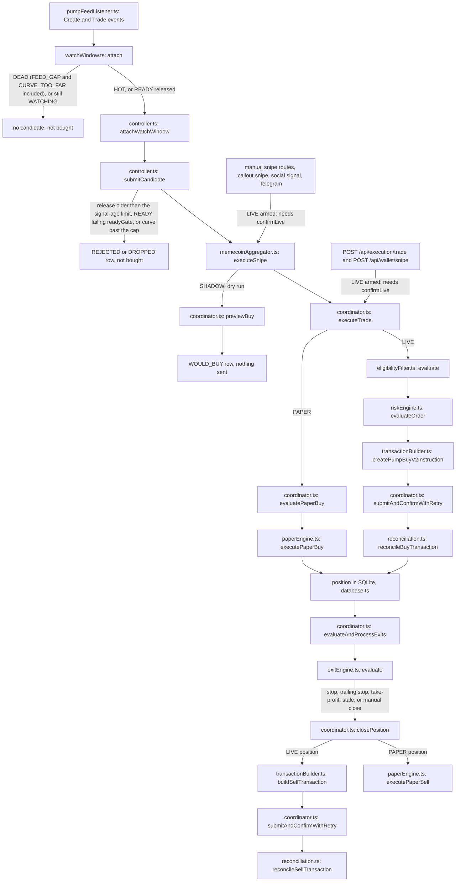

# Architecture

A short map of the code and three diagrams of the parts that decide whether SOL moves. It describes what the code does in the integration snapshot 3f890ed (commit 13c4570: the 767c13a tree plus the later review fixes, the feed delivery watchdog, the late-buy sell after a panic or kill, the disk warning and the harness fixes). The feed, emergency-stop and database-check passages were re-read against that tree on 2026-10-26; the three diagrams were not redrawn, because no gate order changed, not what it was meant to do. Where a claim could not be checked against the code it says so. The time limits that refuse or delay an order are in [`LATENCY.md`](LATENCY.md). **Devnet and localnet only**: nothing here is a route to mainnet or real-money trading.

`tests/architecture_docs.test.ts` checks that every path named below exists and that every function named in a diagram node is still defined in the file shown under it. It cannot check that an arrow still points the right way, so read a diagram against the code when you change the flow it shows.

## Map of the repository

| Path | What it owns | Entry file |
|---|---|---|
| `server.ts` | The Express app, the `/api` routes and the `/ws/engine` WebSocket; boots the feeds, the watch window and the auto controller. | `server.ts` |
| `server/loadEnv.ts` | Loads `.env` (or `APEX_ENV_FILE`) before anything reads the environment. See [`ENV.md`](ENV.md). | `server/loadEnv.ts` |
| `server/solana/` | Everything that touches the chain: the cluster guard, RPC and Jito transports, signer, transaction builder, Pump.fun curve and PumpSwap maths, the live feed listener, read-only mode, execution config. | `server/solana/clusterGuard.ts`, `server/solana/transactionBuilder.ts` |
| `server/execution/` | The one `ExecutionCoordinator` that owns every trade and position, the PAPER engine, post-trade reconciliation, order-size checks and the `confirmLive` guard. | `server/execution/coordinator.ts` |
| `server/auto/` | The auto-snipe controller (modes, session budgets, kill-switch triggers, wallet audit) and its pure trigger rules. | `server/auto/controller.ts` |
| `server/signals/` | The watch window (20 to 120 s of real trades per launch), the confluence score and its single threshold, the eligibility filter, creator and funder lookups. | `server/signals/watchWindow.ts` |
| `server/risk/` | The pre-trade risk engine (limits, circuit breaker, kill switch) and the token safety score. | `server/risk/riskEngine.ts` |
| `server/exits/` | Stop, trailing stop, take-profit ladder and stale exit rules, evaluated every 3 s by the coordinator. | `server/exits/exitEngine.ts` |
| `server/capital/` | Spendable bankroll and order sizing. | `server/capital/capitalSizer.ts` |
| `server/market/` | Pool statistics from real trades, curve depth, trade tape, SOL/USD price. | `server/market/solPriceService.ts` |
| `server/backtest/` | The launch recorder and the replay of the auto rules over recorded launches. The replay and the offline studies in `scripts/` share one fee, cost and latency model, `server/backtest/costModel.ts` (5A). | `server/backtest/replay.ts` |
| `server/system/` | The live system checks behind the System Checks screen and the latency figures. | `server/system/systemChecks.ts` |
| `server/db/` | The SQLite store (`node:sqlite`): positions, orders, transactions, decisions, journal, recordings. | `server/db/database.ts` |
| `server/middleware/` | Operator authentication, origin checks, bind-host rules, file-permission warnings, logging. | `server/middleware/auth.ts` |
| `server/security/` | The list of files that must never enter a release archive or image. | `server/security/secretPaths.ts` |
| `server/core/` | Shared types. | `server/core/types.ts` |
| `server/memecoinAggregator.ts` | Pools and positions for the board, and `executeSnipe`, the common entry for every buy that is not typed straight into the coordinator. | `server/memecoinAggregator.ts` |
| `server/pumpfunService.ts` | Hot callouts, callers and the Pump.fun feed wiring. | `server/pumpfunService.ts` |
| `server/socialScanner.ts` | Social signals and the Telegram command parser. | `server/socialScanner.ts` |
| `server/board.ts`, `server/walletTrader.ts` | The home-board read model and the wallet state and panic liquidation used by the UI. | `server/board.ts` |
| `src/` | The React operator UI (Vite). It holds no keys and sends orders only through the API. | `src/App.tsx` |
| `scripts/` | Smoke test, devnet and localnet harnesses, signer import, release packaging. `scripts/localnet/` is the in-process LiteSVM validator. | `scripts/smoke.ts` |
| `tests/` | The suite (`vitest run`). What the tests do and do not prove: [`TEST_FIDELITY.md`](TEST_FIDELITY.md). | `vitest.config.ts` |
| `docs/` | These documents, including [`LATENCY.md`](LATENCY.md) (stages and time limits) and [`RUNBOOK.md`](RUNBOOK.md); `docs/archive/` holds old reports and plans kept as history and not maintained. | `docs/ARCHITECTURE.md` |

## 1. Trade lifecycle

From a launch on the feed (or a manual click) to a closed position. The auto path is the left column. Auto candidates from the pump feed watch window, auto-snipe callouts (`server/pumpfunService.ts`) and aggregator signals (`server/memecoinAggregator.ts`) all go to `submitCandidate`. Manual snipe routes, the hot-callout snipe button, social signals and the Telegram command join at `executeSnipe` without passing the auto gates. Two operator routes (`POST /api/execution/trade` and `POST /api/wallet/snipe`) skip `executeSnipe` and call `executeTrade` directly, so they skip the pool-level checks and the confluence gate in the `executeSnipe` box (`executeTrade` still runs its own on-chain eligibility check, section 3). Boxes name a function or a route (the file is on the second line); `tests/architecture_docs.test.ts` checks that each named function exists in its file, not that the arrows are right.

Things worth knowing when you read it:

- What each step checks (these were notes on the diagram):
  - `submitCandidate` runs the auto gates: mode not OFF, `AUTO_SNIPE_ENABLED`, one try per mint, one buy in flight, no open position, the watch verdict, the release's age (older than the risk engine's 8 s signal-age limit is `STALE_SIGNAL`, in SHADOW too), for READY `readyGate` (concentration passing and at least 2 strong signals, `READY_TOO_WEAK` otherwise, stage `watch`), the measured curve progress (above `APEX_MAX_CURVE_PROGRESS_PCT`, default 60%, is `CURVE_PROGRESS_TOO_HIGH`, stage `curve`), the coordinator mode matching the auto mode, the position cap and the session budget. "One try per mint" (P4.3): a mint is marked tried only after a send, a buy or would-buy, or a final refusal; a "not now" refusal (`RETRYABLE_REJECTION`: a cooldown, a stale read, the SOL price, a halt) leaves it open, and a watch release refused that way is queued and tried again after `RELEASE_RETRY_MS` (2 s) while it is younger than `pendingReleaseMaxAgeMs` (the signal-age limit minus 2 s for the reads, 6 s). A queued release older than that is journaled `STALE_SIGNAL` without a curve read or risk call. Every decision row carries the release's `passingSignals` in its inputs.
  - `executeSnipe` checks the amount, a fresh SOL price, sizing and the 10 percent cap, a real pool or curve, the freeze authority if required, the creator share if the cap is set, and the confluence score against the threshold if gating is on (default on).
  - `executeTrade` first checks that trading is not halted, that read-only mode does not refuse LIVE, that the mode matches if the caller named one, and (LIVE only) provenance and the signal timestamp.
  - `evaluatePaperBuy` prices from the real curve, refuses a curve past the progress cap (`CURVE_PROGRESS_TOO_HIGH`), then runs eligibility, the capital ceiling and the risk engine. SHADOW's `previewBuy` gets the release time as `signalTimestamp`, so its risk check ages the signal as PAPER and LIVE do.
- The exit pass (`evaluateAndProcessExits`, every 3 s, one pass at a time) evaluates every open position with a fresh mark first, with its own clock, and starts each sell it decides on at once, without awaiting it (`decideAndDispatchExit`). Positions whose mark is stale get their direct read afterwards, `STALE_REFRESH_CONCURRENCY` (4) at a time, and each is evaluated, and its sell started, as soon as its own read returns, so a decided stop-loss never waits behind another position's read (R5-10). The pass then waits for the sells at most `EXIT_SELL_WAIT_MS` (2.5 s). A sell still running after that keeps going; its position is skipped by later passes until it ends (`inFlightPositionExits`), so it is never sent twice, and a hung sell of one position does not hold another position's stop-loss. A take-profit's exit stage advances when its sell fills. A pass that throws (a database read failing) is caught; after `EXIT_LOOP_ALERT_AFTER` (3) failed passes in a row the coordinator raises `EXIT_LOOP_FAILING`, readiness and every LIVE buy are refused, and both clear when a pass completes (R4-6). While `setPanicActive(true)` is in force the pass sends only `PROTECTIVE_EXIT_REASONS` exits; `waitForPositionExit` resolves when a position has no sell running. Every RPC call of the trading connection is bounded by `RPC_REQUEST_TIMEOUT_MS`, and with `RPC_MAX_REQUESTS_PER_SEC` set its wait for a request slot is bounded by `RPC_LIMITER_MAX_WAIT_MS` (`server/solana/rpcConnection.ts`); a request past that bound fails unsent.
- Marks for the exit pass (P1.6): a mint whose price read fails is not read again for 60 s, doubling to 10 min (`MARK_RETRY_BASE_MS`), but only for PAPER positions; a LIVE position is read on every pass unless its mint can never be marked (not a token mint). A LIVE position with no fresh price whose last known mark is already past the hard stop, or below its trailing stop, still gets its STOP_LOSS or TRAILING_STOP (the sell re-reads the curve or pool before it is built); every other exit waits for a price. LIVE marks of a migrated position read the PumpSwap pool on every pass, not from the 15 s pool cache.
- Sends on the RPC (P2.1, S252): the same signed transaction is resent every 1.5 s while it is watched, until it confirms, fails on chain, or the blockhash expires with no status (`BLOCKHASH_EXPIRED`, booked as never landed: the row is TIMED_OUT, a buy does not hold its mint and a sell leaves no pending sell).
- Sell errors (P1.6): anything thrown before the send, and quote, pool and curve-read errors (`QUOTE_MATH_DISCREPANCY`, `BONDING_CURVE_MIGRATED`, `PUMPSWAP_*`, `CURVE_READ_FAILED`, ...), count as no attempt: the slippage ladder and back-off do not move, and quote or build failures raise `EXIT_QUOTE_FAILING`. A send the RPC refuses with a rate limit (HTTP 429, JSON-RPC -32007, "request limit reached") is an unknown outcome, not proof that nothing was sent (S262; S245 had made it definite): a balancer may have forwarded an earlier attempt. A sell is resent, same signed bytes, after 0.5, 1 and 2 s (`SELL_RATE_LIMIT_BACKOFF_MS`); a buy is not resent there. Either is then watched, with resends, until it confirms or its blockhash expires. If every send was rate-limited and it expired unseen, the result is `RPC_RATE_LIMITED`: the row is TIMED_OUT, a sell leaves no pending sell, counts as no attempt and raises `EXIT_RATE_LIMITED`, and a buy fails as `SUBMIT_FAILED`. A send the RPC refuses with HTTP 401, 402 or 403 (an expired plan or a refused key) is definite, not forwarded (R4-10): its error starts `RPC_AUTH_REJECTED`, a sell leaves no pending sell and counts as no attempt, and the coordinator raises the `RPC_AUTH_REJECTED` alert, which any read through the trading Connection that gets one of those statuses raises too. After an `RPC_RATE_LIMITED` sell the exit pass waits a flat 6 s (`EXIT_RATE_LIMITED_WAIT_MS`) before that position's next try, without counting a failure or widening the slippage step; a manual close and a panic are not held back by the wait. A LIVE sell quote that disagrees with the official SDK uses the SDK's net and logs the difference (a buy still fails closed). When only the curve's fee tier cannot be verified, a LIVE sell is still built on the curve with the minimum output at the highest fee tier (`PUMP_SELL_FEE_CEILING_BPS` when the fee config is missing); when the curve itself cannot be read and there is no pool, the refusal names the reason (`CURVE_READ_FAILED (<reason>)`) instead of `UNKNOWN_TRADING_VENUE`. The close schemas take whole percents; `closePosition` computes the share in basis points.
- Clocks (A2, S271). Waits that must end on time read the monotonic clock (`performance.now`), so a wall clock set back or forward cannot stretch them: the RPC limiter's slot booking and wait (`server/solana/rpcConnection.ts`), the confirm watch of both transports, `waitForBuysInFlight` (the emergency stop's wait), and the PumpSwap pool cache. Two deadlines are still stored as wall-clock times. The failed-sell retry deadline (`exitFailures.nextAttemptAt`) is stored as a wall-clock time, but since A3 `exitRetryWaitMs` also counts the wait down on the monotonic clock (`setAtMono`, set with each wait, including the 6 s rate-limit wait) and returns the smallest of the wall-clock time left, the wait that was set (`waitMs`) and the monotonic time left. A wall clock set back after a failed sell was recorded therefore no longer holds that position's exits, its stop-loss included, past the wait; a clock set forward still releases it early. The pending-sell window (100 s) is the other, and since R4-8 it decides only for a sell recorded with no `lastValidBlockHeight` (a ledger row from before P2.1): every other pending sell is released only when it failed on chain or `pendingSellCannotLand` proves it expired (confirmed block height past its `lastValidBlockHeight`, no signature status), never on the clock; a send time ahead of now restarts the window at now. Mark ages that gate an exit are monotonic too (R4-3): `applyMarkPrice` keeps a `performance.now()` stamp per position next to the wall stamp, the mark-feed clock (feed heartbeat, `getFeedAges`, readiness) is set with its monotonic time, and a stored wall stamp ahead of the wall clock counts as stale, so the position gets a direct read. Curve marks carry the time their RPC context slot was first seen (R4-9, `PumpCurveService.noteContextSlot`): reads ask for at least the highest slot seen on that Connection (`minContextSlot`), a read from an older slot is refused, and a node stalled on one slot serves marks that age. The signal-age checks and `claimExit`'s staleness check compare real event times and need the wall clock.
- The feed (P4.2). `server/solana/pumpFeedListener.ts` subscribes to the pump program's logs and to slot changes on the trading Connection. A websocket close, no slot for `FEED_SLOT_SILENCE_MS` (10 s, once a first slot was seen), a slot jump above `FEED_SLOT_JUMP_MAX` (25), an RPC switch, or a subscription that delivers nothing (below) is a gap: the status is `RECONNECTING` and a `feed_gap` event makes `server/signals/watchWindow.ts` release every active launch `DEAD` with `FEED_GAP` (no backfill: logs from the gap are never replayed by web3.js). A gap ends, and the status goes back to `ACTIVE`, in three ways (`closeGap` in `server/solana/pumpFeedListener.ts`): the socket reopens; a slot notification arrives in order (after a slot jump that is the slot after the jump, so a jump keeps the status at `RECONNECTING` until then); or, for a gap opened by an RPC switch only, the first log from the new subscription. Ending a gap does not bring back launches already released `DEAD`. The status is `ACTIVE` only once the server confirms the log subscription (web3.js's subscription state; a Connection that cannot report it counts as confirmed). Delivery watchdog: when no log and no slot arrived for `FEED_NO_DELIVERY_MS` (15 s) since the subscription was made, the socket reopened or the last delivery, and either the log subscription was never confirmed or the slot subscription was, a `NO_DELIVERY` gap opens and the subscription moves to a fresh Connection to the same endpoint (queued with the RPC switches). Each try that delivers nothing doubles the wait, up to `FEED_NO_DELIVERY_MAX_WAIT_MS` (300 s), and from the `FEED_NO_DELIVERY_TRIES_BEFORE_ERROR`-th (third) try the status is `ERROR` until a log or slot arrives. A confirmed subscription with no slot heartbeat is left alone (a quiet devnet goes minutes without a pump log). Only the listener holds a websocket: exits and marks read over HTTP. A successful `setRpcEndpoint` moves the subscription to the new Connection (`onConnectionChange`, `switchConnection`) and clears the pump Global/FeeConfig cache. A CreateEvent whose `quote_mint` is not SOL is not emitted, and the curve read refuses a non-SOL quote in PAPER as well as LIVE.
- Boot modes (`pumpBootMode` in `server/pumpfunService.ts`): with external feeds on, `FULL` (log stream plus the pump.fun / DexScreener HTTP pollers) only when the cluster value is `mainnet-beta` (a read-only server), otherwise `WS_ONLY` (log stream only); with `APEX_DISABLE_EXTERNAL_FEEDS=true`, `WS_ONLY` with `APEX_PUMP_WS_ONLY=true` on localnet, otherwise `OFF`. `startBackground` refuses the pollers off mainnet whatever it is asked. The Hot Callouts board's feed status (`feedStatus` in `GET /api/pumpfun/callouts`, from `PumpFunService.getStatus()`) is `NO_DATA` until a feed event has brought data, `ONLINE` while the last one is at most `PUMP_FEED_ONLINE_WINDOW_MS` (60 s, read on `performance.now()`) old, and `STALE` after that; a failed HTTP poll does not count, and `liveSource` stays "none yet" until a feed delivers (3H). With `APEX_DISABLE_EXTERNAL_FEEDS=true`, `GET /api/connectivity/diagnostics` does not contact Telegram, X, pump.fun or DexScreener: those four rows read `SKIPPED` (reply field `externalFeedsDisabled: true`) and only the cluster RPC is probed; the Jito row comes from `getJitoReadiness()`, and there is no Coinbase or Avellaneda row any more.
- The watch window only releases a launch after at least 20 s and at most 120 s of real trades. An auto candidate from any source is dropped unless the window has released it (`NOT_IN_WATCH_WINDOW`, `WATCH_PENDING` or `WATCH_DEAD`). A sell by the creator cluster (the creator, the create signer, or a wallet either of them funded) is the exception to the 20 s: it marks the launch `DEAD` at once (`CREATOR_SOLD`). The cluster's trades are not counted in the velocity, flow and net-inflow signals.
- Seller funders (B3). A seller whose funder is not known yet is looked up with priority (`server/signals/funderLookup.ts`, ahead of the queue and not held to the per-mint bound), and the watch window holds a launch in `WATCHING` ("waiting for the funder of N seller(s)") while any such lookup is outstanding, up to the end of the 120 s window. A seller whose funder cannot be read, or whose lookup is still outstanding at the window end, costs the launch a signal, not the launch: it counts as an unknown funder in `funderCoverage`, so the `buyers` signal cannot pass, and its sell stays in the organic flow. The launch is not released `DEAD` for it (an earlier draft released `SELLER_FUNDER_UNKNOWN`; the code has no such reason). A lookup that answers "in the creator cluster" still releases `CREATOR_SOLD`. With no lookup wired (replay, fixtures) nothing waits. `WatchWindow.getSellerFunderStats()` counts the sellers asked, unreadable, and still pending at the window end, and the System checks capacity row shows them.
- The manual routes do not go through the auto controller or its watch window. `POST /api/memecoins/trade`, the callout snipe, the social snipe and the WebSocket snipe run the `executeSnipe` checks; `POST /api/execution/trade` and `POST /api/wallet/snipe` run only `executeTrade`'s own checks (section 3). Those include the on-chain eligibility filter (freeze authority, creator and top-10 share) in both PAPER and LIVE, but there is no confluence gate and no `executeSnipe` pool check on those two; they use no pools, so the placeholder-pool question does not arise.
- A `HOT` release has already cleared the confluence threshold inside the window; a `READY` release must also pass `readyGate` and is checked against the threshold again before the buy. One threshold serves both (`server/signals/confluenceThreshold.ts`). In `DEVNET_LIVE` the score a buy needs is never below `CONFLUENCE_DEVNET_LIVE_FLOOR` (50), HOT included, whatever the threshold is set to.
- Curve progress is the share of the curve's 793.1M tokens sold (pump.fun's bar, `curveProgressOf` in `server/market/poolStats.ts`), in all three places it is checked: the watch window (DEAD `CURVE_TOO_FAR`, from the first trade on), the controller (the feed-measured figure) and the coordinator's fresh curve read (authoritative, every caller). 60% of the tokens sold is about 24 SOL of real reserves. With the token reserve unknown the progress is unknown, never real SOL over 85 (`curveProgressOf` returns null): the watch window and the controller let it through, and a LIVE buy is refused on the coordinator's fresh read (`CURVE_PROGRESS_UNREADABLE`). The curve panel's depth figure uses the same token share.
- In PAPER the fill is priced from the real curve when it can be read; otherwise a flat model is used and the position is marked unverified.
- `executeSnipe` can build a "pool" for a mint it has no market data for. The auto controller passes `noSyntheticPool`, which refuses the demo pools and `pool-simulated-*` ones; manual PAPER snipes can still use those. A `pool-callout-*` placeholder (built from a hot callout when the curve could not be read, never in LIVE) is not on that refusal list, so a PAPER or SHADOW candidate from a callout can reach one. Those placeholder pools carry fixed liquidity and price figures; they are marked `unverified` or given `SYNTHETIC_TEST` provenance, and LIVE refuses that provenance.

## 2. Auto mode states

Auto starts OFF at every start (3E). The mode is still saved in the database (`app_settings`), but `restorePersisted` only reports it in the startup note ("the last run was in PAPER; auto starts OFF at every start") and sets the saved value to OFF so it says what is running (one exception: when another live process holds this database's lock file, it restores nothing and leaves the saved mode as it is); the operator sets the mode again, and DEVNET_LIVE needs a fresh arm and confirmation code. A crash loop therefore cannot keep trading, and an unattended restart stops auto trading until someone sets a mode. A kill (`kill()`, which the kill switch, a panic and `POST /api/auto/kill` all reach) writes `auto.mode = OFF` and `auto.kill = {reason, ts}` before its first await, so a crash or a stuck sell cannot leave the old mode saved; `restorePersisted` then keeps a killed run OFF and killed, and any `setMode` clears the record (3E). The confluence threshold is saved and does come back at startup. The kill triggers (`evaluateKillTriggers`): `NEGATIVE_EXPECTANCY` and `LOSS_STREAK` read the last `LOSS_TRIGGER_TRADES` (20) closed positions auto opened, in the same execution mode, across sessions and restarts, closed after the last operator acknowledgement (`app_settings` `auto.lossTriggerAck`, set by `POST /api/auto/resume {ackLossTriggers:true}`); while those trades trip either one, `setMode` to PAPER or DEVNET_LIVE is refused with `LOSS_TRIGGERS_NEED_ACK`. `WALLET_UNKNOWN` (DEVNET_LIVE) fires only after the balance has been unknown for more than `READINESS_RED_LIMIT_MS` (10 s, counted on `performance.now()`); a caller that passes no duration still fires at once. The wallet-audit halt path does not write `auto.kill`; its mode change is saved through the normal mode event and the halt by the coordinator. An operator can call `setMode` to any target its checks allow, in either direction (the diagram draws the usual upward arrows only). The server moves a mode down (to SHADOW or OFF) and puts a PAPER session back after a readiness-only downgrade.

```mermaid
stateDiagram-v2
  [*] --> OFF: every start (a saved mode is reported, not restored; a saved kill stays killed)
  OFF --> SHADOW: setMode, AUTO_SNIPE_ENABLED must be true
  OFF --> PAPER: setMode, coordinator must be in PAPER
  OFF --> DEVNET_LIVE: setMode, LIVE armed, code CONFIRM_AUTO_DEVNET, ALLOWED_CLUSTER not mainnet-beta, not read-only
  SHADOW --> PAPER: setMode
  SHADOW --> DEVNET_LIVE: setMode, same conditions
  PAPER --> SHADOW: checkTriggers, a kill trigger fires
  DEVNET_LIVE --> SHADOW: checkTriggers, a kill trigger fires
  SHADOW --> PAPER: tryAutoRestore, only after READINESS_RED, green for 60 s
  PAPER --> SHADOW: enforceBudgets, a session budget runs out
  DEVNET_LIVE --> SHADOW: enforceBudgets, a session budget runs out
  PAPER --> OFF: kill
  SHADOW --> OFF: kill
  DEVNET_LIVE --> OFF: kill, or auditWallet finds an unexplained balance change, or dropDevnetLiveIfUnarmed, LIVE disarmed or kill switch on
```

In SHADOW the auto gates and the `executeSnipe` checks run, then the PAPER gates through `previewBuy` (never the LIVE-only checks, but with the release's signal timestamp, so a stale release fails `STALE_SIGNAL` as in PAPER), and the decision is journalled as `WOULD_BUY`. Nothing is sent and exits keep running. `DEVNET_LIVE` allows one open position (`DEVNET_MAX_OPEN_POSITIONS`), on devnet or localnet only, is refused in read-only mode, and buys nothing scoring below 50 (`CONFLUENCE_DEVNET_LIVE_FLOOR`) whatever the threshold. The one-position cap counts open LIVE positions that are not adopted dust (`RECOVERED`), plus unresolved LIVE buys (3B); an open PAPER or SHADOW position does not block `DEVNET_LIVE`, because the slot is real SOL (`autoSnipeController` filters the ACTIVE rows on `executionMode === 'LIVE'`).

Budget limits (buys, spend, loss, time) are checked when a candidate arrives and when the status is read, so a quiet session whose time limit has passed drops to SHADOW when someone next looks or the next candidate comes. The operator can also call `setMode` directly to any target its checks allow (the arrows above show the conditions, not who may fire them). The operator kill switch (`POST /api/execution/kill-switch`) and the panics run one emergency stop (`server/execution/emergencyStop.ts`): kill switch on, auto killed to OFF after any buy in flight, coordinator disarmed. A LIVE buy already past the risk gate that lands after the stop is sold at once (late buy, decision 5 of 2026-10-26): the stop bumps the coordinator's `emergencyStopSeq` first (`noteEmergencyStop`), each LIVE buy notes the count at its gate, and a buy whose position is saved under a newer count (on confirmation, or later by orphan recovery or a reconciliation pass in the same process) goes to `sellLateBuy`, which is `closePosition(id, 100, 'EMERGENCY_PANIC_LIQUIDATION')`: one try, one more after an exit already running on it, then `LATE_BUY_SOLD` or `LATE_BUY_NOT_SOLD`. A `DEVNET_LIVE` session that finds the coordinator disarmed or the kill switch on (at a candidate, a monitor tick or a status read) also turns itself OFF (`dropDevnetLiveIfUnarmed`), so re-arming LIVE never revives it. A kill trigger that drops `DEVNET_LIVE` to SHADOW also disarms the coordinator (S207, `checkTriggers` calls `armLiveTrading(false)`), so the manual routes cannot send either until an operator arms again. Budget drops (`enforceBudgets`) and a PAPER trip do not touch the arming. An unexplained wallet balance change also calls `haltAll`. That halt stops every buy, is written to the database so it survives a restart, and is cleared only by `POST /api/auto/resume` with `clearHalt`. While halted, only stop-loss, trailing-stop, emergency and manual closes run; take-profit and stale-position exits are refused until the halt is cleared (`PROTECTIVE_EXIT_REASONS` in `server/execution/coordinator.ts`). Read-only mode allows OFF, SHADOW and PAPER only.

## 3. What a live send must pass

LIVE means a signed transaction on devnet or localnet. Everything on the left must hold to arm; everything on the right is checked for each LIVE buy in the order shown. The per-buy readiness gate (`liveBuyReadinessProblems`) runs twice: at the start of the LIVE branch, and again in the Q17 block right before the send, because a curve read, holder lookup, snapshot, build and signature sit between approval and sending. A LIVE sell does not go through this diagram (see below).

```mermaid
flowchart TD
  subgraph arm["To arm: armLiveTrading"]
    a0["not read-only"] --> a1["confirmation code"]
    a1 --> a2["the real-money environment switch is on"]
    a2 --> a2b["ALLOWED_CLUSTER is not mainnet-beta"]
    a2b --> a3["coordinator.ts: getLiveReadiness"]
  end
  a3 --> t0
  subgraph trade["For each LIVE buy: executeTrade"]
    t0["not halted, not read-only, mode matches if the caller named one"] --> t1["provenance is a real source and signal timestamp is present"]
    t1 --> t2["still armed, signer READY, ALLOWED_CLUSTER not mainnet-beta"]
    t2 --> t2b["coordinator.ts: liveBuyReadinessProblems"]
    t2b --> t3["real bonding curve read, not migrated, progress at most APEX_MAX_CURVE_PROGRESS_PCT"]
    t3 --> t4["EligibilityFilter passes"]
    t4 --> t5["one open LIVE position per mint"]
    t5 --> t6["spendable bankroll above zero and 10 percent ceiling"]
    t6 --> t7["quote, balance covers worst case, in-flight orders, unresolved LIVE buys and the reserve"]
    t7 --> t8["round-trip cost, counting the three sells of the exit ladder, at most 20 percent of the order"]
    t8 --> t9["riskEngine.ts: evaluateOrder"]
    t9 --> t10["no buy of this mint in flight or unresolved"]
    t10 --> b1["reconciliation.ts: capturePreTradeSnapshot"]
    b1 --> b2["transactionBuilder.ts: buildBuyTransaction"]
    b2 --> b3["coordinator.ts: blockhashProblem, only when APEX_VERIFY_BLOCKHASH is true"]
    b3 --> b4["signer.ts: signTransaction"]
    b4 --> q17["Q17: still armed, mode LIVE, not halted, kill switch off, liveBuyReadinessProblems again, send deadline not passed"]
    q17 --> b5["database.ts: saveOrder"]
  end
  b5 --> subm
  subgraph submit["submitAndConfirmWithRetry"]
    subm["readOnly.ts: assertNotReadOnly"] --> c1["clusterGuard.ts: assertSendClusterAllowed"]
    c1 --> c2["clusterGuard.ts: assertClusterAllowedCached"]
    c2 --> c3["database.ts: savePendingBuyIfNoneUnresolved"]
    c3 --> c4["coordinator.ts: submitAndConfirmInner, kill switch and halt again before each send and resend of a BUY"]
  end
  c4 --> c5["transports.ts: submit"]
  c5 --> f1["coordinator.ts: journalLiveBuySolDelta, one LIVE_BUY_FILLED row per landed buy"]
  m["manual one-click route: confirmLive true, liveConfirmationRefusal"] -.-> t0
```

`getLiveReadiness` (checked when arming, and by `GET /api/execution/can-arm`) requires: not read-only, the real-money environment switch, signer READY, wallet balance above the 0.015 SOL reserve, database writable, `DEMO_MODE` off, startup reconciliation `EXECUTION_READY`, RPC `HEALTHY` (not `DEGRADED`, which is above 800 ms), position mark feed healthy, no halt, kill switch off, the boot alert `KILL_SWITCH_WAS_ON` cleared (T1), circuit breaker closed, and Jito ready or not configured. The pump event stream and real-market feed ages count only for a read-only server watching mainnet, which can never be armed.

**Per-buy readiness (3A, R1-0).** Arming is not the only time these are read. Every LIVE buy runs the cheap subset again, with direct reads and no cache: the RPC is not flagged as off the allowed cluster (`clusterProblem`), the RPC is not `DISCONNECTED` (`DEGRADED` is allowed here), the database is writable, startup reconciliation is `EXECUTION_READY`, the circuit breaker is `CLOSED`, the mark feed is not `STALE`, the exit loop is not failing (`EXIT_LOOP_FAILING`, R4-6), the heartbeat's slot is not going backwards or stalled (R4-9), and `DEMO_MODE` is off. A failure at the start refuses the buy as `LIVE_NOT_READY: <reasons>` and journals `TRADE_RISK_REJECTED` with `reason: LIVE_NOT_READY`; a failure at the Q17 block, after the order was signed, refuses it as `ENTRY_REVOKED` and journals `TRADE_REVOKED_BEFORE_SEND`, and nothing is sent. The Q17 block checks the armed flag, the mode, the halt and the kill switch together with readiness, and the send deadline (R3-28: the earlier of the signal time plus the risk engine's signal-age limit and the market-data time plus its data-age limit); `submitAndConfirmInner` checks the kill switch, the halt and the deadline again right before the first send of a BUY, and the kill switch and halt before every Jito resend, the RPC fallback and the RPC watch's resends (R1 #8). A BUY stopped after it was already sent once is reported unconfirmed, so orphan recovery and the late-buy sell handle it if it lands. A SELL is never held by these checks; at the start the halt and the armed flag are checked first and the kill switch is the risk engine's first gate. Sells never call `liveBuyReadinessProblems`, so a red readiness does not hold back an exit. The unit-test setup stubs the method to an empty list (`tests/setup/devnetGuard.ts`); only `tests/s3a_per_buy_readiness.test.ts` runs the real one, so the other LIVE-buy suites do not exercise this gate.

**Database writable (DBW).** `isWritable()` (the database leg of both readiness checks) commits an upsert into the one-row `db_health` table and also needs `MIN_FREE_BYTES` (32 MiB, Mike's choice on 2026-10-26; it was 16 MiB) free on the database's filesystem (`statfs`); below `LOW_FREE_WARN_BYTES` (128 MiB) free it still passes, but the System checks database row is WARN and a `DISK_SPACE_LOW` operator alert is raised (from the 30 s cached status read, `checkSqliteJournalOk`); any error is false, and `:memory:` databases skip the free-space part. A pass is reused for `WRITABLE_CACHE_MS` (1 s) on the monotonic clock, a failure is never cached. Inside that 1 s a disk that fills is not noticed by the check; the buy's own PENDING-row write would still fail and throw.

**What happens after the send is approved (code order).** After the second readiness check the coordinator writes the `orders` row (`saveOrder`; the table is written here and never read or updated: nothing else in `server/` touches it) and calls `submitAndConfirmWithRetry`. That function answers an order already recorded as landed (`alreadyLandedResult`) before anything is written, then runs the read-only check, `assertSendClusterAllowed` and the cached genesis check, and only then writes the PENDING transaction row (`savePendingBuyIfNoneUnresolved`: the check for another unresolved buy of the mint and the row are one database transaction), so an order refused by those guards leaves no row. `submitAndConfirmInner` then repeats the read-only check, `assertSendClusterAllowed`, a refusal while the heartbeat has `clusterProblem` set, and the cached genesis check (the pass is cached, so the repeat costs no RPC call), and `SolanaRpcTransport.submit` calls `assertSendClusterAllowed` once more as the lowest choke point. A refusal before the PENDING row leaves nothing behind; a failure after it that proves the transaction never landed turns the row `TIMED_OUT` or `REVERTED`.

**A LIVE sell** (`closePosition`) runs: `assertSendClusterAllowed` (before anything is built), venue resolution (curve or PumpSwap), quote and `buildSellTransaction`, the pre-trade snapshot, the opt-in blockhash check, signature, a `simulateTransaction` on the configured RPC (a failed simulation sends nothing), then `submitAndConfirmWithRetry`. So a sell is signed and simulated before the cached genesis check in `submitAndConfirmWithRetry`. It does not need LIVE armed, the kill switch off or readiness green; it needs a READY signer, not read-only, a non-mainnet `ALLOWED_CLUSTER` and the genesis check (section 1, exit pass).

**Risk engine gates (`evaluateOrder`).** In order, the first failure returns its reason code: kill switch (`KILL_SWITCH_ACTIVE`), circuit breaker (`CIRCUIT_BREAKER_OPEN`), 15 s cooldown after a failed trade (`EXECUTION_DISABLED`), 30 s per-mint cooldown (`DUPLICATE_MINT`), market data older than 5 s (`STALE_MARKET_DATA`), signal older than 8 s (`STALE_SIGNAL`), a position, exposure or loss limit that is not a positive number (`RISK_LIMIT_INVALID`, 6b), order above the position cap (`MAX_POSITION_SIZE`), aggregate exposure above 3 positions' worth and at most 3 simultaneous positions (`MAX_EXPOSURE`), the **net daily PnL floor** (`DAILY_LOSS_LIMIT`, gate 10), slippage (`SLIPPAGE_TOO_HIGH`), price impact (`PRICE_IMPACT_TOO_HIGH`), total execution cost (`FEE_TOO_HIGH`), fee share of the position (`EXPECTED_EDGE_BELOW_EXECUTION_COST`), the **worst-case floor** (`DAILY_LOSS_LIMIT`, gate 13b, after the fee gates so an oversized fee keeps its own reason), then the wallet reserve (`INSUFFICIENT_BALANCE`).
- Gate 10 (3C) is a net daily PnL floor: net PnL (realized, plus open unrealized, minus unbooked fees) over a rolling 24 hours, not since UTC midnight, so earlier profit widens the floor. The floor is `MAX_DAILY_LOSS_USD` at the SOL price when that price was read within the last hour; with an older price it is the smaller of 3 x `MAX_POSITION_SIZE_SOL` and `MAX_DAILY_LOSS_USD` at the last known price, and with no price ever read it is 3 x `MAX_POSITION_SIZE_SOL` (`effectiveMaxDailyLossSol`). Reaching it **latches** the refusal for that mode (LIVE and PAPER separately); the latch is held in memory and stays until an operator sends `POST /api/auto/resume` with `{"clearDailyLossLatch":true}`, a flag separate from `clearHalt` (which does not clear it). The refusal says when the oldest loss leaves the 24 h window. After a restart the window still holds the losses, so the next buy latches again; a restart more than 24 h after the losses starts unlatched. Clearing the latch while the window itself is below the floor changes nothing: gate 10 refuses and latches again.
- Gate 13b (3C) refuses a buy when net PnL would fall below the floor if the new order (with its fee and tip) and every open position, at its marked value, went to zero (`WORST_CASE_LOSS_FRACTION` = 1). It refuses; it does not clamp the size. When the floor is smaller than one order with its costs, every buy of that size is refused with a message naming `MAX_DAILY_LOSS_USD`, and the log warns once.
- The auto kill trigger `DAILY_LOSS_LIMIT` reads `riskEngine.getDailyTotalPnLSol`, so it follows the same 24 h window; it does not set the latch (the latch is set only when a buy is evaluated).
- `riskControls.maxDailyLossSol` in `GET /api/diagnostics/system`, and the "Daily loss limit" line of the Plug-and-Play screen that shows it, read the risk limits' own field (3 x the position cap unless pinned), not `effectiveMaxDailyLossSol()`, which is the floor in force. 3C flagged this and did not change it.

**Unresolved LIVE buys and the fill journal (3B).** A LIVE buy that was sent and is not resolved (a `PENDING` or `RECONCILIATION_REQUIRED` row in the ledger) can still land and become a position, so `getUnresolvedLiveBuys` counts it until reconciliation or orphan recovery settles it. In `executeTrade`, after the quote, each such buy (a) adds its worst case to the `INSUFFICIENT_FUNDS_CONCURRENCY` reserve check, next to the buys in flight in this process, and (b) is added to the open-position count the risk engine sees (`currentOpenPositionsCount`). Its worst case is the quoted `maxInputLamports` (or the order amount) plus tip, priority fee, base fee and token-account rent; a row with no readable quote is priced at the largest order the risk limits allow. A row whose buy already has an `ACTIVE` position is not counted again, and neither is this process's own buy still in `executeTrade` (it counts as in flight). A buy that landed and left the wallet but is still unread can be counted twice; that refuses one buy too many, never one too few. If the ledger cannot be read the buy is refused (`UNRESOLVED_BUY: the ledger of unresolved LIVE buys could not be read`). The auto controller uses the same count in three places: the DEVNET_LIVE cap (`DEVNET_MAX_OPEN_POSITIONS` counts open LIVE positions that are not adopted dust, plus unresolved LIVE buys, and no longer an `ACTIVE` PAPER row; an unreadable ledger drops the candidate), the wallet audit, and the session `spentSol`. The audit (`auditWalletChange`) holds a wallet drop up to the unresolved buys' worst case, plus one rent allowance each, as theirs and keeps its old mark, so the look after recovery covers both; a rise or a larger drop still halts. Every landed LIVE buy, whoever placed it (auto, a manual route, Telegram, orphan recovery, startup recovery), writes one decision-journal row with `outcome = 'LIVE_BUY_FILLED'`, `stage = 'fill'`, `position_id` the buy signature and `sol_delta` the whole wallet delta (curve spend, tip, fees and rent) as a negative number, so the audit can explain it; the auto controller's `BOUGHT` row carries no `sol_delta`, so a buy is counted once. A confirmed auto buy adds that journaled delta to `session.spentSol`; a buy that returned unresolved adds its worst case, which `settleUnresolvedSpend` swaps for the real delta once recovery adopts it, and one that never lands keeps the worst case for the session. A reverted buy's fee is not journaled (a few thousand lamports, inside the audit's base tolerance). Source: the 3B patch notes; the code paths above were read in this tree, but the localnet and devnet results quoted in those notes were not re-run here.

The provenance and signal-timestamp checks apply to LIVE only; PAPER runs its own gate (`evaluatePaperBuy`) instead of everything after the provenance row. The "mode matches" check does nothing for the two direct manual routes, which name no mode; the auto controller does name one.

`assertClusterAllowed` compares the RPC's genesis hash with the allowed cluster's and refuses if it cannot read it, so a mainnet RPC cannot send even if every earlier check passed. On the send path a pass is remembered per Connection object for 60 seconds (`assertClusterAllowedCached`), so each order does not pay for a genesis RPC call; a new connection, a changed `ALLOWED_CLUSTER` or an expired entry checks again. A failed genesis check removes the pass (`forgetGenesisCheck`), whether it fails on the send path or in the 10 s heartbeat (`verifyCluster`), and so does switching the RPC endpoint (`setRpcEndpoint`); while the heartbeat has the RPC flagged (`clusterProblem` is set), `submitAndConfirmInner` refuses every buy and sell with `CLUSTER_GUARD` until a later check passes, and a LIVE close or exit is refused with `CLUSTER_GUARD` before it reads any wallet balance, so the position stays open (P1.6). A LIVE row is closed without a sell on an empty balance only when that read can be trusted: the RPC passes the cluster check and answers from a slot at or after the buy's (`BALANCE_UNTRUSTED` otherwise). The `mainnet-beta` refusal is never cached. An opt-in second check (`APEX_VERIFY_BLOCKHASH=true`, `verifyBlockhashIndependently`) asks the public devnet RPC whether each LIVE order's blockhash exists on devnet before signing, which a configured RPC that lies about its genesis hash would fail. The code still accepts a `mainnet-beta` value of `ALLOWED_CLUSTER`, but only so a read-only server can watch mainnet: while it is set, `armLiveTrading`, the LIVE branch of `executeTrade` and the send path (`assertSendClusterAllowed`) all refuse, and DEVNET_LIVE refuses it too. `confirmLive` is a guard against an accidental click, not a security boundary: the operator token is the authorisation ([`KNOWN_RISKS.md`](../KNOWN_RISKS.md) section 7).

## Code that looks functional and is not

Some settings and functions are accepted, stored and shown, and change nothing. [`KNOWN_RISKS.md`](../KNOWN_RISKS.md) section 6 lists them, and `tests/q34_known_risks.test.ts` checks that the list is still true. Treat a name that sounds like a trading control with suspicion until you have found what reads it.
