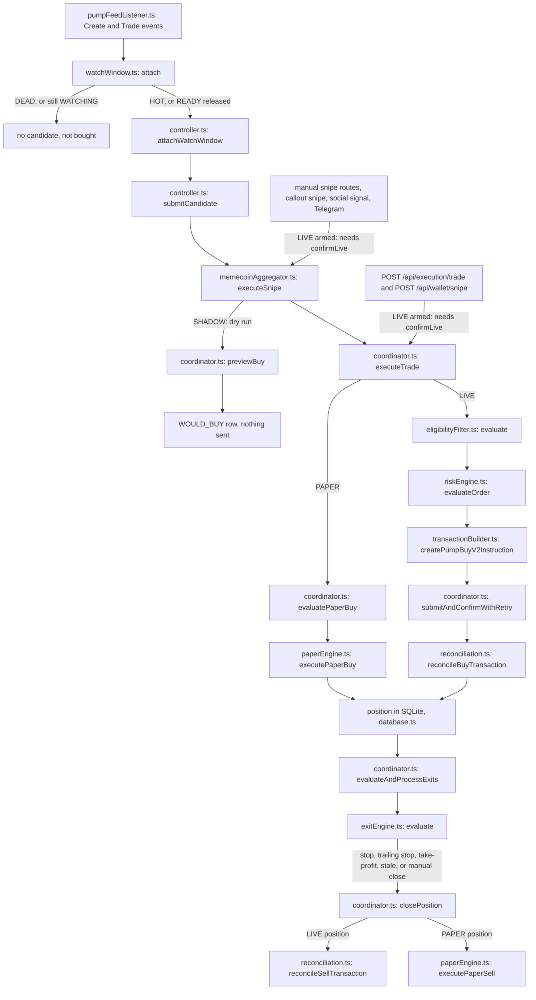
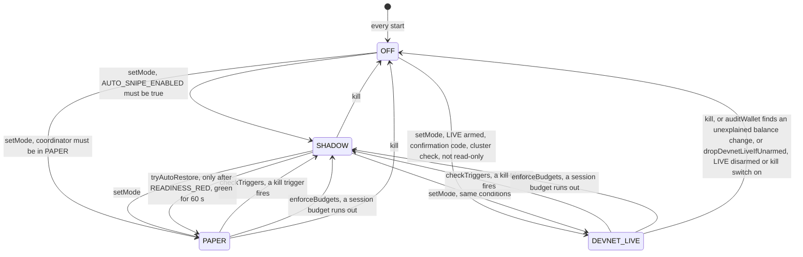
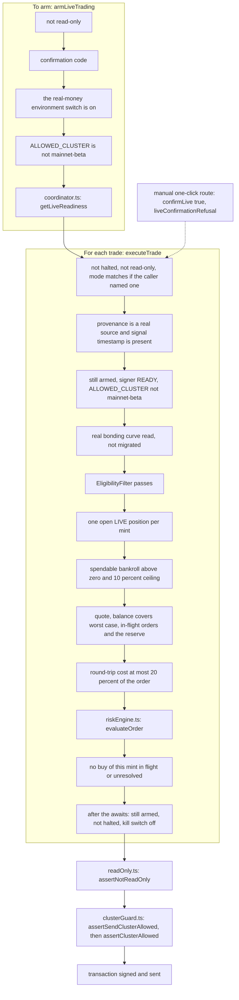

# Architecture

A short map of the code and three diagrams of the parts that decide whether SOL moves. It describes what the code does at commit 1a80181 plus patches 199 to 205, not what it was meant to do. **Devnet and localnet only**: nothing here is a route to mainnet or real-money trading.

`tests/architecture_docs.test.ts` checks that every path named below exists and that every function named in a diagram node is still defined in the file shown under it. It cannot check that an arrow still points the right way, so read a diagram against the code when you change the flow it shows.

## Map of the repository

| Path | What it owns | Entry file |
|---|---|---|
| `server.ts` | The Express app, the `/api` routes and the `/ws/engine` WebSocket; boots the feeds, the watch window and the auto controller. | `server.ts` |
| `server/loadEnv.ts` | Loads `.env` (or `APEX_ENV_FILE`) before anything reads the environment. See [`ENV.md`](ENV.md). | `server/loadEnv.ts` |
| `server/solana/` | Everything that touches the chain: the cluster guard, RPC and Jito transports, signer, transaction builder, Pump.fun curve and PumpSwap maths, the live feed listener, read-only mode, execution config. | `server/solana/clusterGuard.ts`, `server/solana/transactionBuilder.ts` |
| `server/execution/` | The one `ExecutionCoordinator` that owns every trade and position, the PAPER engine, post-trade reconciliation, order-size checks and the `confirmLive` guard. | `server/execution/coordinator.ts` |
| `server/auto/` | The auto-snipe controller (modes, session budgets, kill-switch triggers, wallet audit) and its pure trigger rules. | `server/auto/controller.ts` |
| `server/signals/` | The watch window (20 to 120 s of real trades per launch), the confluence score and its single threshold, the eligibility filter, creator and funder lookups. | `server/signals/watchWindow.ts` |
| `server/risk/` | The pre-trade risk engine (limits, circuit breaker, kill switch) and the token safety score. | `server/risk/riskEngine.ts` |
| `server/exits/` | Stop, trailing stop, take-profit ladder and stale exit rules, evaluated every 3 s by the coordinator. | `server/exits/exitEngine.ts` |
| `server/capital/` | Spendable bankroll and order sizing. | `server/capital/capitalSizer.ts` |
| `server/market/` | Pool statistics from real trades, curve depth, trade tape, SOL/USD price. | `server/market/solPriceService.ts` |
| `server/backtest/` | The launch recorder and the replay of the auto rules over recorded launches. | `server/backtest/replay.ts` |
| `server/system/` | The live system checks behind the System Checks screen and the latency figures. | `server/system/systemChecks.ts` |
| `server/db/` | The SQLite store (`node:sqlite`): positions, orders, transactions, decisions, journal, recordings. | `server/db/database.ts` |
| `server/middleware/` | Operator authentication, origin checks, bind-host rules, file-permission warnings, logging. | `server/middleware/auth.ts` |
| `server/security/` | The list of files that must never enter a release archive or image. | `server/security/secretPaths.ts` |
| `server/core/` | Shared types. | `server/core/types.ts` |
| `server/memecoinAggregator.ts` | Pools and positions for the board, and `executeSnipe`, the common entry for every buy that is not typed straight into the coordinator. | `server/memecoinAggregator.ts` |
| `server/pumpfunService.ts` | Hot callouts, callers and the Pump.fun feed wiring. | `server/pumpfunService.ts` |
| `server/socialScanner.ts` | Social signals and the Telegram command parser. | `server/socialScanner.ts` |
| `server/board.ts`, `server/walletTrader.ts` | The home-board read model and the wallet state and panic liquidation used by the UI. | `server/board.ts` |
| `src/` | The React operator UI (Vite). It holds no keys and sends orders only through the API. | `src/App.tsx` |
| `scripts/` | Smoke test, devnet and localnet harnesses, signer import, release packaging. `scripts/localnet/` is the in-process LiteSVM validator. | `scripts/smoke.ts` |
| `tests/` | The suite (`vitest run`). What the tests do and do not prove: [`TEST_FIDELITY.md`](TEST_FIDELITY.md). | `vitest.config.ts` |
| `docs/` | These documents; `docs/archive/` holds old reports kept as history and not maintained. | `docs/ARCHITECTURE.md` |

## 1. Trade lifecycle

From a launch on the feed (or a manual click) to a closed position. The auto path is the left column. Auto candidates from the pump feed watch window, auto-snipe callouts (`server/pumpfunService.ts`) and aggregator signals (`server/memecoinAggregator.ts`) all go to `submitCandidate`. Manual snipe routes, the hot-callout snipe button, social signals and the Telegram command join at `executeSnipe` without passing the auto gates. Two operator routes (`POST /api/execution/trade` and `POST /api/wallet/snipe`) skip `executeSnipe` and call `executeTrade` directly, so they skip the pool-level checks and the confluence gate in the `executeSnipe` box (`executeTrade` still runs its own on-chain eligibility check, section 3). Boxes name a function or a route (the file is on the second line); `tests/architecture_docs.test.ts` checks that each named function exists in its file, not that the arrows are right.

Things worth knowing when you read it:

- What each step checks (these were notes on the diagram):
  - `submitCandidate` runs the auto gates: mode not OFF, `AUTO_SNIPE_ENABLED`, one try per mint, one buy in flight, no open position, the watch verdict, the coordinator mode matching the auto mode, the position cap and the session budget.
  - `executeSnipe` checks the amount, a fresh SOL price, sizing and the 10 percent cap, a real pool or curve, the freeze authority if required, the creator share if the cap is set, and the confluence score against the threshold if gating is on (default on).
  - `executeTrade` first checks that trading is not halted, that read-only mode does not refuse LIVE, that the mode matches if the caller named one, and (LIVE only) provenance and the signal timestamp.
  - `evaluatePaperBuy` prices from the real curve, then runs eligibility, the capital ceiling and the risk engine.
- The exit pass (`evaluateAndProcessExits`, every 3 s, one pass at a time) first evaluates every open position with its own clock, then starts all the sells it decided on together, without awaiting them one by one, and waits for them at most `EXIT_SELL_WAIT_MS` (2.5 s). A sell still running after that keeps going; its position is skipped by later passes until it ends (`inFlightPositionExits`), so it is never sent twice, and a hung sell of one position does not hold another position's stop-loss. A take-profit's exit stage advances when its sell fills. While `setPanicActive(true)` is in force the pass sends only `PROTECTIVE_EXIT_REASONS` exits; `waitForPositionExit` resolves when a position has no sell running. Every RPC call of the trading connection is bounded by `RPC_REQUEST_TIMEOUT_MS` (`server/solana/rpcConnection.ts`).
- Marks for the exit pass (P1.6): a mint whose price read fails is not read again for 60 s, doubling to 10 min (`MARK_RETRY_BASE_MS`), but only for PAPER positions; a LIVE position is read on every pass unless its mint can never be marked (not a token mint). A LIVE position with no fresh price whose last known mark is already past the hard stop still gets its STOP_LOSS (the sell re-reads the curve or pool before it is built); every other exit waits for a price. LIVE marks of a migrated position read the PumpSwap pool on every pass, not from the 15 s pool cache.
- Sell errors (P1.6): anything thrown before the send, and quote, pool and curve-read errors (`QUOTE_MATH_DISCREPANCY`, `BONDING_CURVE_MIGRATED`, `PUMPSWAP_*`, `CURVE_READ_FAILED`, ...), count as no attempt: the slippage ladder and back-off do not move, and quote or build failures raise `EXIT_QUOTE_FAILING`. A LIVE sell quote that disagrees with the official SDK uses the SDK's net and logs the difference (a buy still fails closed). When only the curve's fee tier cannot be verified, a LIVE sell is still built on the curve with the minimum output at the highest fee tier (`PUMP_SELL_FEE_CEILING_BPS` when the fee config is missing); when the curve itself cannot be read and there is no pool, the refusal names the reason (`CURVE_READ_FAILED (<reason>)`) instead of `UNKNOWN_TRADING_VENUE`. The close schemas take whole percents; `closePosition` computes the share in basis points.
- The watch window only releases a launch after at least 20 s and at most 120 s of real trades. An auto candidate from any source is dropped unless the window has released it (`NOT_IN_WATCH_WINDOW`, `WATCH_PENDING` or `WATCH_DEAD`). A sell by the creator is the exception to the 20 s: it marks the launch `DEAD` at once.
- The manual routes do not go through the auto controller or its watch window. `POST /api/memecoins/trade`, the callout snipe, the social snipe and the WebSocket snipe run the `executeSnipe` checks; `POST /api/execution/trade` and `POST /api/wallet/snipe` run only `executeTrade`'s own checks (section 3). Those include the on-chain eligibility filter (freeze authority, creator and top-10 share) in both PAPER and LIVE, but there is no confluence gate and no `executeSnipe` pool check on those two; they use no pools, so the placeholder-pool question does not arise.
- A `HOT` release has already cleared the confluence threshold inside the window; a `READY` release is checked against it again before the buy. One threshold serves both (`server/signals/confluenceThreshold.ts`).
- In PAPER the fill is priced from the real curve when it can be read; otherwise a flat model is used and the position is marked unverified.
- `executeSnipe` can build a "pool" for a mint it has no market data for. The auto controller passes `noSyntheticPool`, which refuses the demo pools and `pool-simulated-*` ones; manual PAPER snipes can still use those. A `pool-callout-*` placeholder (built from a hot callout when the curve could not be read, never in LIVE) is not on that refusal list, so a PAPER or SHADOW candidate from a callout can reach one. Those placeholder pools carry fixed liquidity and price figures; they are marked `unverified` or given `SYNTHETIC_TEST` provenance, and LIVE refuses that provenance.

## 2. Auto mode states

The mode is saved in the database (`app_settings`) and `restorePersisted` brings it back at startup, up to PAPER: a saved `DEVNET_LIVE` comes back as SHADOW and needs a fresh arm and confirmation code, and without `AUTO_SNIPE_ENABLED=true` auto stays OFF. A first start is OFF. The confluence threshold is saved and restored the same way. An operator can call `setMode` to any target its checks allow, in either direction (the diagram draws the usual upward arrows only). The server moves a mode down (to SHADOW or OFF) and puts a PAPER session back after a readiness-only downgrade.

In SHADOW the auto gates and the `executeSnipe` checks run, then the PAPER gates through `previewBuy` (never the LIVE-only checks), and the decision is journalled as `WOULD_BUY`. Nothing is sent and exits keep running. `DEVNET_LIVE` allows one open position, on devnet or localnet only, and is refused in read-only mode.

Budget limits (buys, spend, loss, time) are checked when a candidate arrives and when the status is read, so a quiet session whose time limit has passed drops to SHADOW when someone next looks or the next candidate comes. The operator can also call `setMode` directly to any target its checks allow (the arrows above show the conditions, not who may fire them). The operator kill switch (`POST /api/execution/kill-switch`) and the panics run one emergency stop (`server/execution/emergencyStop.ts`): kill switch on, auto killed to OFF after any buy in flight, coordinator disarmed. A `DEVNET_LIVE` session that finds the coordinator disarmed or the kill switch on (at a candidate, a monitor tick or a status read) also turns itself OFF (`dropDevnetLiveIfUnarmed`), so re-arming LIVE never revives it. A kill trigger that drops `DEVNET_LIVE` to SHADOW also disarms the coordinator (S207, `checkTriggers` calls `armLiveTrading(false)`), so the manual routes cannot send either until an operator arms again. Budget drops (`enforceBudgets`) and a PAPER trip do not touch the arming. An unexplained wallet balance change also calls `haltAll`. That halt stops every buy, is written to the database so it survives a restart, and is cleared only by `POST /api/auto/resume` with `clearHalt`. While halted, only stop-loss, trailing-stop, emergency and manual closes run; take-profit and stale-position exits are refused until the halt is cleared (`PROTECTIVE_EXIT_REASONS` in `server/execution/coordinator.ts`). Read-only mode allows OFF, SHADOW and PAPER only.

## 3. What a live send must pass

LIVE means a signed transaction on devnet or localnet. Everything on the left must hold to arm; everything on the right is checked for each trade in the order shown, and the last check happens again after the awaits that sit between approval and sending.

`getLiveReadiness` requires: signer READY, balance above the 0.015 SOL reserve, database writable, startup reconciliation `EXECUTION_READY`, RPC HEALTHY, position mark feed healthy, no halt, kill switch off, circuit breaker closed, and Jito ready or not configured.

The provenance and signal-timestamp checks apply to LIVE only; PAPER runs its own gate (`evaluatePaperBuy`) instead of everything after the provenance row. The "mode matches" check does nothing for the two direct manual routes, which name no mode; the auto controller does name one.

`assertClusterAllowed` compares the RPC's genesis hash with the allowed cluster's and refuses if it cannot read it, so a mainnet RPC cannot send even if every earlier check passed. On the send path a pass is remembered per Connection object for 60 seconds (`assertClusterAllowedCached`), so each order does not pay for a genesis RPC call; a new connection, a changed `ALLOWED_CLUSTER` or an expired entry checks again. A failed genesis check removes the pass (`forgetGenesisCheck`), whether it fails on the send path or in the 10 s heartbeat (`verifyCluster`), and so does switching the RPC endpoint (`setRpcEndpoint`); while the heartbeat has the RPC flagged (`clusterProblem` is set), `submitAndConfirmInner` refuses every buy and sell with `CLUSTER_GUARD` until a later check passes, and a LIVE close or exit is refused with `CLUSTER_GUARD` before it reads any wallet balance, so the position stays open (P1.6). A LIVE row is closed without a sell on an empty balance only when that read can be trusted: the RPC passes the cluster check and answers from a slot at or after the buy's (`BALANCE_UNTRUSTED` otherwise). The `mainnet-beta` refusal is never cached. An opt-in second check (`APEX_VERIFY_BLOCKHASH=true`, `verifyBlockhashIndependently`) asks the public devnet RPC whether each LIVE order's blockhash exists on devnet before signing, which a configured RPC that lies about its genesis hash would fail. The code still accepts a `mainnet-beta` value of `ALLOWED_CLUSTER`, but only so a read-only server can watch mainnet: while it is set, `armLiveTrading`, the LIVE branch of `executeTrade` and the send path (`assertSendClusterAllowed`) all refuse, and DEVNET_LIVE refuses it too. `confirmLive` is a guard against an accidental click, not a security boundary: the operator token is the authorisation ([`KNOWN_RISKS.md`](../KNOWN_RISKS.md) section 7).

## Code that looks functional and is not

Some settings and functions are accepted, stored and shown, and change nothing. [`KNOWN_RISKS.md`](../KNOWN_RISKS.md) section 6 lists them, and `tests/q34_known_risks.test.ts` checks that the list is still true. Treat a name that sounds like a trading control with suspicion until you have found what reads it.
